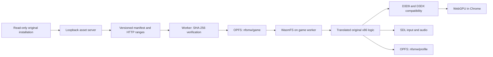

# Private browser runtime

The tested URL is **http://127.0.0.1:8080/**. Click Play to validate/download the original files into OPFS, then run the translated game locally. Keep the game tab and Chrome window visible. This is a local development deployment, not a public hosted service. Nothing streams gameplay from the Windows executable.

## Data and execution path



`tools/assets.py` binds only `127.0.0.1`. It serves an explicit game-file allowlist, rejects traversal and path escapes, checks the Host and Origin, and supplies COOP `same-origin`, COEP `require-corp`, CORP `same-origin`, and the Wasm MIME type. Chrome accepts loopback HTTP as a secure context; that was measured rather than assumed. LAN access, HTTPS termination, accounts and a licensed public distribution backend are not implemented.

The generated manifest contains relative paths, lengths, full SHA-256 hashes and 4 MiB chunk hashes. Its version is the SHA-256 of the canonical manifest payload. The supported executable hash is pinned in both producer and client. Current data: 1,356 files, 3,024,656,547 bytes, manifest version `103fd8f56ab59c7ec9dd598b66f4b1c6fa15c2a92aa2fae4c140786f7943e230`.

The dedicated module worker verifies existing OPFS chunks, fetches only missing/invalid ranges, checks response length/Content-Range and SHA-256, then writes and flushes each verified chunk. Interrupted work retains the verified prefix. Memory is bounded by chunk buffers, not the complete 3 GB installation. A Web Lock serializes sync workers. Files stay under `nfsmw/game`; the host's profile path is `/opfs/nfsmw/profile`. Storage persistence is requested but the browser may decline; clearing site storage removes both assets and saves. Changing host spelling or port changes the origin and therefore its OPFS cache.

The manual upstream importer remains unchanged at `reference/nfsmw-recomp/build/web-site` for diagnosis. The user-facing site is separately staged under `build/site`; it contains no file picker or archive upload. Diagnostic pages intentionally run stronger cache tests and should not be opened during gameplay: the game may hold OPFS handles.

## Host and build details

The original game runs on a pthread; the browser main thread owns events, GPU work and presentation. The upstream build uses WasmFS/OPFS, 24 preallocated pthreads, an initial 1 GiB Wasm memory with growth up to 4 GiB, and SDL3. The web player requests supported BC texture compression, depth/stencil and float filtering features. Its D3D9/D3DX shader path targets WebGPU. These are compatibility implementations, not proof that every original API call behaves correctly.

The original upstream Wasm is retained at 561,083,929 bytes for debugging. Staging removes only `.debug_*` custom sections, resulting in 152,284,486 bytes. `tools/compact_wasm.py` hashes the concatenation of every retained section before and after; both hashes are `2d48ea5727240fc30ce439af7761dd9e3c75e4e54d4584f4b69429203760cae1`. No instruction, data, function table, import/export or non-debug custom section is rewritten. The compacted artifact was subsequently booted in Chrome and reached the original 3D world.

The served `.js` is 468,888 bytes and `.data` is 8,535,904 bytes. `.data` contains host resources/mod metadata, not the full retail asset installation. All generated binaries, logs, manifests and original-derived C are ignored local artifacts.

## Tested Windows environment

- Windows PowerShell; Python 3.11 virtual environment at `.venv`.
- CMake 4.1.2, Ninja 1.13.0, clang-format 23.1.1.
- Emscripten 4.0.23 and Node 22.16.0, reused read-only from the earlier local SDK; separate caches/config in this workspace's `.tools`.
- Ghidra 12.1.4 with Android Studio's JDK 21; existing `speed_exe` project exported with `-readOnly -noanalysis`.
- Chrome 155, Windows, AMD RDNA3 WebGPU adapter. Secure context, cross-origin isolation, shared memory, workers and real GPU buffer submission passed.
- No WSL development distro was required. The Windows build completed successfully; Linux/WSL commands have not been tested here.

Commands below run from the inner `NFS_MW_Browser_Port_Starter` folder. The local installation/SDK paths are examples from the tested machine, not dependencies the browser user must install.

```powershell
$gameDir = 'C:\Users\festi\Downloads\WebMostWanted\NFS-Most-Wanted-2005\Need For Speed Most Wanted Black Edition'
$sdkDir = 'C:\Users\festi\Downloads\WebMostWanted\browser-port\.tools\emsdk-4.0.23'
python inventory_game.py --game-dir $gameDir --out artifacts/inventory.json
python tools/assets.py manifest --game-dir $gameDir
.\.venv\Scripts\python.exe tools/audit.py --game-dir $gameDir
.\.venv\Scripts\python.exe tools/run_build.py --emsdk $sdkDir --regenerate --jobs 4
python tools/stage_web.py
python tools/assets.py serve --game-dir $gameDir --port 8080
```

The server command remains running. Stop it with Ctrl+C when finished. The already staged build needs only the final server command, or `scripts/serve.ps1`; it does not need another compilation or manual asset import.

For a clean developer checkout, first clone and pin the actual build inputs:

```powershell
git clone --recurse-submodules https://github.com/veritr1x/nfsmw-recomp.git reference/nfsmw-recomp
git -C reference/nfsmw-recomp checkout bb95925d5b58656b8b23e9df6eb0c9647be1bece
git -C reference/nfsmw-recomp submodule update --init --recursive
python -m venv .venv
.\.venv\Scripts\python.exe -m pip install -r reference/nfsmw-recomp/kit/requirements-dev.txt
.\.venv\Scripts\python.exe reference/nfsmw-recomp/tools/setup.py --install $gameDir --link-only
```

The SDK must already be installed/activated at `$sdkDir`. `tools/run_build.py` writes its own Emscripten config and uses separate cache/ports directories, preserving the existing project. The exact commands and exit status are recorded in `artifacts/build-latest.json` and its referenced log. The successful full build took approximately 27 minutes including fetching host dependencies; this is not a promised clean-build duration.

The tested analysis export reused the existing Ghidra project:

```powershell
.\scripts\export.ps1 `
  -GhidraHome "$gameDir\source_code\.tools\ghidra_12.1.4_PUBLIC" `
  -JavaHome 'C:\Program Files\Android\Android Studio\jbr' `
  -ExistingProjects "$gameDir\source_code\projects" `
  -ProjectName speed_exe
```

A machine without this prior analysis must first analyze the exact executable using upstream's documented Ghidra flow. That fresh-import path was not rerun during this session. Ghidra pseudocode is not directly compiled, and generated `build/recomp/gen` files must not be edited to hide translation failures.

## Diagnostics

- `/diagnostics.html`: WebGPU/isolation and real 3 GB OPFS interruption/resume/cache/corruption-repair test. It changes only the browser asset copy and repairs it; never original files or saves.
- `/timing.html`: animation/timer scheduling control with no game, Wasm or WebGPU.
- `/nfsmw/index.html?diagnostics=1`: optional DOM-visible frame scheduling, trusted input, error and runtime log observations. Ordinary Play omits this panel.
- Runtime environment diagnostics are supported by upstream query keys starting `RECOMP_`, e.g. `RECOMP_AUDIO_TRACE=100` on a future diagnostic boot. Logging may change timing and must not be treated as a fix for a race-loading stall.

First run at a tiny/occluded browser surface delivered about 1 animation callback per second, while timers remained at 10 Hz. The no-game control reproduced it. After the user brought Chrome visibly forward, callbacks reached about 30 Hz and original 3D gameplay became visible. A foreground window is therefore part of the current test conditions. Original scene frame throughput can be lower than callback frequency; the overlay/logs record dropped frames and occasional 250 ms target-pool stalls.

The audio sink initializes at 48 kHz stereo with a 2,048-frame period. Its `starved` counter counts an empty SDL queue when the pull begins; that alone is not proof of silent output. Late pulls and their gaps are recorded. The user subsequently confirmed audible music/engine sounds in the manual gameplay test; waveform fidelity and latency have not been measured.

The `M_ID` exceptions seen in the diagnostic overlay came from a `chrome-extension://.../executors/200.js` URL, not the game source. No browser extensions or security settings were changed.
